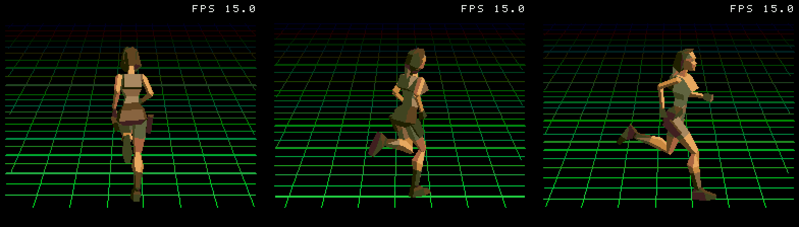

# ssp16as: SSP1601 Assembler and Disassembler

**Two-pass assembler and disassembler for the Samsung SSP1601 DSP of the Sega Virtua Processor (SVP, Sega 315-5750). Full SSP1601 instruction set as decoded by the MAME disassembler, labels, equ, org, dw, expressions, the espp preprocessor (.include, .equ, .macro, .rept, .if), listing file, three output formats. Strict C99, POSIX getopt(), libc only. Project svp-lara, Mike Wolak, EPROM Foundry Inc.**

<p align="center"></p>
<p align="center"><sub><b>Figure 1.</b> SVP cartridge demonstration assembled with ssp16as: a 15-part, 375-face figure in an 11-pose running cycle, rotating about Y, over a perspective floor that scrolls along the figure's heading. Frames 141, 181 and 221 of the cartridge built from `examples/svp-demo` (CRC-32 879EDF24), Genesis Plus GX through the libretro interface, 256 x 224, scaled 2x. The figure data is derived from Tomb Raider (Core Design Ltd., 1996) and is not part of this repository or any distribution.</sub></p>

---

## 1 Features

| Item | Specification |
|---|---|
| Instruction set | 28 instruction forms: ld (11 addressing forms), ldi (3), sub/cmp/add/and/or/eor (7 forms each), mod (8 accumulator operations), 8 flag operations, call, bra, mld, mpya, mpys, nop, ret |
| Registers | `-` X Y A ST STACK PC P EXT0..EXT6 AL; aliases PM0 PM1 PM2 XST PM4 PMC |
| Pointer registers | r0..r7 with the modifiers none, `+!`, `-`, `+`; r3 and r7 with `\|00` `\|01` `\|10` `\|11` |
| Conditions | always, gpi0, gpi1, l, z, ov, n, diof, gpi2, gpi3 with `=0` or `=1`; reserved codes c1, c11..c15 |
| Source | labels `name:`, `NAME equ EXPR`, `org EXPR` (word address), `dw EXPR,...`; espp directives (section 6) |
| Expressions | 0x/$ hexadecimal, decimal, symbols, `+ - * / % << >> & \| ^ ~`, parentheses; 32-bit host `long` |
| Output | `image`: a cartridge image with the words placed at byte 2w (base image with `-b`); `raw`: big-endian words from the lowest to the highest address; `s`: GNU as `.org`/`.word` source for the 68000 side |
| Listing | address, words, canonical disassembly and source line, with build time and word range |
| Disassembler | canonical text that re-assembles to the same words; a word with no canonical encoding is written as `dw` |
| Errors | `FILE:LINE: error: message`, provenance through `.include` and macro expansion |
| Verification | dasm/asm round trip of all 65,536 opcode words and of the Virtua Racing (USA) SSP program, byte-identical; 31,947 instructions compared with MAME's disassembler, 0 different (section 8) |
| Size | 883 lines of C plus espp (671 lines); no dependency beyond the C library |

## 2 General Description

The SVP is the Sega Mega Drive / Genesis cartridge co-processor of Virtua Racing (1994): a Samsung SSP1601 16-bit fixed-point DSP with 64 K words of program space mapped onto the cartridge ROM, two 256-word internal RAMs, eight pointer registers, a 16 x 16 multiplier with a 32-bit accumulator, and 128 KB of cartridge DRAM shared with the 68000.

ssp16as assembles SSP1601 source into a cartridge image in one call: the 68000 program is the base image (`-b`) and the SSP program words are placed at their program addresses (word w at bytes 2w and 2w+1). The disassembler produces source in the same notation, which re-assembles to identical words; it serves to read existing SVP programs and as the assembler's own test oracle against MAME.

The command structure, listing format, error reporting and preprocessor come from esdsp, the ES5510 assembler of project dp4 (Mike Wolak, EPROM Foundry Inc.); the instruction tables are written from the SSP1601 encodings (section 5).

## 3 Build

1. `make` builds `ssp16as` with `cc -std=c99 -O2 -Wall -Wextra -pedantic`; 0 warnings (Apple clang, macOS 26, arm64).
2. `make test` builds `tests/mame_dasm` from MAME's `ssp1601d.cpp` and runs gates O, V and E (section 8). Inputs `MAME_SSP` and `VR_ROM`.
3. `make clean` removes the objects, the binaries and `tests/out/`.

## 4 Usage


```
ssp16as asm  [-o OUT] [-f image|raw|s] [-b BASE] [-s BYTES] [-l LST] [-I DIR] [-D N[=V]] FILE.s
ssp16as dasm [-o OUT] [-r FIRST:END] FILE.bin
ssp16as isa
```

| Option | Function |
|---|---|
| `-o OUT` | output file; `out.bin` for asm, standard output for dasm |
| `-f FMT` | asm output format: `image` (default with `-b`), `raw` (default without `-b`), `s` |
| `-b BASE` | base image (the 68000 program); assembled words replace its bytes 2w, 2w+1 |
| `-s BYTES` | minimum image size for `image` |
| `-l LST` | listing file |
| `-I DIR` | include directory for `.include` (after the including file's directory) |
| `-D N[=V]` | predefined espp symbol |
| `-r FIRST:END` | dasm word range, END exclusive; default 0x0400:0x10000 (the SSP's cartridge program space) |

Program memory is 64 K words. Word w is bytes 2w and 2w+1 of the cartridge image, big-endian. The SSP starts at word 0x0400 (byte 0x0800); assembly starts there unless an `org` says otherwise.

## 5 Instruction Encoding

| Encoding | Syntax |
|---|---|
| `0000 0000 dddd ssss` | `ld d, s` (`nop` = 0x0000, `ret` = 0x0065) |
| `0000 001j dddd mmpp` / `0000 010j ssss mmpp` | `ld d, (ri)` / `ld (ri), s` |
| `0000 011j aaaa aaaa` / `0000 111j aaaa aaaa` | `ld A, ramj[a]` / `ld ramj[a], A` |
| `0000 1000 dddd 0000` + imm | `ldi d, imm16` |
| `0000 101j dddd mmpp` | `ld d, ((ri))` |
| `0000 110j 0000 mmpp` + imm | `ldi (ri), imm16` |
| `0001 001j dddd mmpp` / `0001 010j ssss mmpp` | `ld d, ri` / `ld ri, s` |
| `0001 1jpp iiii iiii` | `ldi ri, imm8` |
| `0100 1010 dddd 0000` | `ld d, (A)` |
| `ooo0 0000 0000 ssss`, `ooo0 001j 0000 mmpp`, `ooo0 011j aaaa aaaa`, `ooo0 1000 0000 0000` + imm, `ooo0 101j 0000 mmpp`, `ooo1 001j 0000 mmpp`, `ooo1 1000 iiii iiii` | `OP A, s`, `OP A, (ri)`, `OP A, ramj[a]`, `OPi A, imm16`, `OP A, ((ri))`, `OP A, ri`, `OPi imm8`; ooo 1 sub, 3 cmp, 4 add, 5 and, 6 or, 7 eor |
| `0100 100f cccc 0000` + addr / `0100 110f cccc 0000` + addr | `call cond, addr` / `bra cond, addr` |
| `1001 000f cccc 0ooo` | `mod cond, ror\|rol\|shr\|shl\|inc\|dec\|neg\|abs` |
| `1001 0100 0000 ffff` | `resl setl resie setie resop setop res set` |
| `0011 011b mmjj mmii` / `1001 011b ...` / `1011 011b ...` | `mpys (rj), (ri), b` / `mpya ...` / `mld ...`; rj r4..r7, ri r0..r3, b default 1 |

Sources of the encodings: svpdoc.txt section 2.4 (Grazvydas Ignotas, in Genesis Plus GX `core/cart_hw/svp/`), MAME `src/devices/cpu/ssp1601/ssp1601d.cpp` (Pierpaolo Prazzoli, Grazvydas Ignotas, BSD-3-Clause). The MiSTer SSP160x core (Genesis_MiSTer adc0c42, GPL-3.0) decodes a subset: conditions always, z, n; mod operations shr, shl, neg, abs. The assembler accepts the full set; a program for the MiSTer core uses the subset.

## 6 Preprocessor

espp (section 11) runs before the assembler: `.include "FILE"`, `.equ NAME VALUE` (also `.define`, `.set`, `NAME = VALUE`), `.undef`, `.macro NAME P1, ...` / `.endm`, `.rept N` / `.endr`, `.ifdef`, `.ifndef`, `.if EXPR`, `.else`, `.endif`, `.error`, `.warning`. espp substitutes text; `equ` is the assembler's own symbol definition and takes an expression with labels.

## 7 Example: SVP Demonstration Cartridge

`examples/svp-demo` is the complete source of the cartridge in Figure 1: SSP renderer, 68000 program, table generator, bit-exact reference model, instruction-level simulator and the emulator capture tool. The SSP program is assembled with ssp16as.

### 7.1 Cartridge

| Item | Value |
|---|---|
| SSP program | `mesh.s`, 1,229 lines; words 0x0400-0xBFA7 (48,040 words) in the Lara build, including the generated pose, projection and floor tables |
| 68000 program | `crt0.s` (vectors, header, H- and V-interrupt handlers), `main.c` (frame command, DMA, frame counter, floor gradient) |
| Cartridge | 262,144 bytes; header serial `MK-1229 ` at 0x183 (the MiSTer Genesis core's SVP test) and `SV` at 0x1C8 (Genesis Plus GX's test); MAME maps the SVP only through its software list or for a 2 MB image named Virtua Racing at 0x150, so this image is not mapped by MAME (section 9.4.4) |
| Scene | 15 rigid parts, 300 vertices and 375 faces per pose; 11 poses of a running cycle; rotation 4/256 turn per frame; 3 materials x 4 shades |
| Floor | perspective grid to a horizon at z = -5,664, cells of 160 units, scrolling along the figure's heading with a 64-frame period; drawn by the SSP in one palette entry |
| Floor shading | the 68000's H-interrupt rewrites palette entry 13 in horizontal blank on each display line, from black at the horizon (line 22) to green (0, 7, 2) at line 207: 27 colours (`--grad-pure`, default) or 68 colours (`GRAD=`) |
| Frame buffer | 256 x 192, 4 bits per pixel, two buffers in cartridge DRAM; the 68000 copies the finished buffer to VRAM by DMA in 4 windows per frame with the display blanked from line 208 |
| Frame counter | "FPS dd.d" in eight sprites, measured by the 68000 over at least 1 s of vertical blanks |

### 7.2 Measured

| Item | Value |
|---|---|
| SSP instructions per frame (ssp16sim, frames 1-64) | Lara build: 300,458 minimum, 348,396 maximum, 321,222 mean; mannequin build: 305,322 / 330,993 / 319,545 |
| Correctness | 64 of 64 frames of each build byte-identical to `mesh_model.py` in ssp16sim; 37 of 37 Genesis Plus GX screens equal to a model frame, the displayed frame advancing by 1 every 4 video frames |
| Frame rate, Genesis Plus GX | 15.0 frames/s (frame counter) |
| Frame rate, MiSTer Genesis core on a Pano Logic G2 | 15.0 frames/s (frame counter) with a single floor colour and a worst frame of 348,086 SSP instructions; the raster gradient build (CRC-32 879EDF24) is untested there |
| Original SVP hardware | untested |

### 7.3 Build

Requirements: `m68k-elf-gcc` and `m68k-elf-objcopy` (tested with GCC 16.2.0), a C99 compiler, Python 3 with NumPy and Pillow (tested with Python 3.9.6, NumPy 2.0.2, Pillow 11.3.0). The Lara build also requires a Tomb Raider (1996) PC level file `LEVEL1.PHD` (format version 0x20); `make shots` requires a Genesis Plus GX libretro core.

1. `make -C examples/svp-demo` builds ssp16as if needed, then `gen/mesh.bin` (mannequin figure, CRC-32 15B18770), `gen/mesh_noroom.bin`, `gen/ssp16sim` and `gen/lrshot`.
2. `make -C examples/svp-demo lara LARA_PHD=/path/to/LEVEL1.PHD` builds `gen/lara_run.bin` (CRC-32 879EDF24 from the level file of section 7.4). The level file is read in place; no data derived from it is written outside `gen/`.
3. `make -C examples/svp-demo verify` runs ssp16sim for frames 1-64 of every built cartridge against the model.
4. `make -C examples/svp-demo shots CORE=/path/to/genesis_plus_gx_libretro.dylib` runs each cartridge in the core and compares the screens with the model.
5. The image runs in Genesis Plus GX and in the MiSTer Genesis core; MAME does not map the SVP for it (section 9.4.4, untested in MAME).

### 7.4 Figure data

| Item | Value |
|---|---|
| Source | Tomb Raider (1996), Core Design Ltd.; PC level file LEVEL1.PHD, SHA-256 prefix 75306547c82d8e14 |
| Extraction | `extract.py`: Lara (moveable 0), animation 11 + run cycle frames 0-20 in steps of 2; `svp_model.py` and `mkmesh.py` scale, centre and quantise the meshes |
| Distribution | neither the level file nor any data derived from it is part of this repository; `.gitignore` excludes `gen/` and level files |

### 7.5 Files

| File | Function |
|---|---|
| `Makefile` | targets all, lara, verify, shots, clean |
| `mesh.s` | SSP1601 renderer: clear, transform, projection, cull, flat-shaded triangle fill, floor lines |
| `crt0.s`, `cart.ld`, `main.c` | 68000 start-up, header, link map, frame command loop, DMA, H-interrupt gradient, frame counter |
| `mkmesh.py` | generates `tables.inc`, `palette.h` and `mesh.json` (geometry, poses, projection and floor tables) |
| `extract.py`, `svp_model.py` | TR1 PC level reader and posed-model builder for the Lara build |
| `mesh_model.py`, `verify.py` | bit-exact Python model of the renderer; comparison against ssp16sim and emulator captures |
| `ssp16sim.c` | SSP1601 instruction-level simulator with the SVP's PM and XST registers, C99 |
| `lrshot.c`, `include/libretro.h` | headless libretro front end: runs a cartridge for N frames, writes screens, DRAM and 68000 RAM |
| `mkrom.py` | pads the image and writes the header checksum |

## 8 Gates (`make test`)

| Gate | Check | Result (measured) |
|---|---|---|
| O | 65,536 entries (every opcode word, extension word 0x1234): `dasm` then `asm` gives the same 131,072 words; every entry decoded as an instruction has the same text as MAME's disassembler after the notation map | round trip byte-identical; 13,102 instructions equal, 0 different; 52,434 words emitted as `dw`, 19,666 of which MAME decodes (non-canonical encodings with don't-care bits set) |
| V | Virtua Racing (USA), CRC-32 7E1A324A, words 0x0400-0xFFFF: `dasm` then `asm` gives the same 122,880 bytes; text equal to MAME's at every common instruction start | round trip byte-identical; 18,845 instructions equal, 0 different |
| E | a source using `.include`, `.equ`, `.macro`, `.rept` assembles to the same words as its flat form; 8 faulty lines reported as `FILE:LINE: error` | pass |

Notation map (`tests/cmpdasm.py`): MAME prints hexadecimal without prefix, `ld d, imm` for `ldi d, imm`, the 9-bit address for `ramB[a]`, `always` for `always=1`, `RESERVED` for c1 and c11..c15, `add` for sub (its `arith_ops[1]`) and `mpya` for mpys (opcode group 0x1B). The last two are naming defects of `ssp1601d.cpp`; the gate compiles that file unchanged and maps the names.

Gate inputs: `MAME_SSP` (default `~/H3000/build/mame/src/devices/cpu/ssp1601`, MAME 0.289), `VR_ROM` (a Virtua Racing (USA) cartridge image supplied by the user, read in place, never copied or distributed; default `~/Genesis_Roms/Virtua Racing (USA).md`):

```
make test VR_ROM=/path/to/Virtua\ Racing\ \(USA\).md
```


## 9 SVP Data Sheet

Sega Virtua Processor (SVP): the Sega 315-5750 cartridge chip with its Samsung SSP1601 DSP core, as found in the Virtua Racing cartridge for the Sega Mega Drive / Genesis. No Sega or Samsung data sheet for the 315-5750 is published. Every fact below is taken from a named source (Section 9.8): the reverse-engineered register document svpdoc.txt, the emulators Genesis Plus GX and MAME 0.289, the MiSTer Genesis core, and the demonstration cartridge in `examples/svp-demo/`. Where the sources differ, each one is stated. Behaviour on Sega silicon is untested by this project; svpdoc.txt states that none of its information was verified on real hardware.

### 9.1 Overview

#### 9.1.1 Cartridge

| Item | Value | Source |
|---|---|---|
| Title | Virtua Racing, the only released cartridge with the SVP; versions USA, Japan and two Europe revisions; three share identical SSP code | svpdoc.txt 1 |
| Header serial (USA) | `GM MK-1229 -00` at bytes 0x180-0x18D | Virtua Racing (USA) image, CRC-32 7E1A324A |
| Header serial (Japan) | `G-7001` | MiSTer `Genesis.sv` detection table |
| Board components | IC1 SVP 315-5750, IC2 mask ROM 4116FBB14, IC3 DRAM TC511664BJ-80, IC4 74HC04, IC5 74HC08 | MiSTer `docs/svp/SVPCart.pdf` (cartridge schematic) |
| ROM | 2 MB (2,097,152 B), 16-bit; 68000 bytes 0x000000-0x1FFFFF | svpdoc.txt 1, 3; header ROM range 0x000000-0x1FFFFF |
| DRAM | 128 KB (64 K x 16), TC511664BJ-80; shared by the 68000 and the SSP | svpdoc.txt 1; SVPCart.pdf |
| IRAM | 2 KB (1,024 words) instruction RAM in the 315-5750 | svpdoc.txt 1, 3 |
| Memory controller | Address mapping for the SSP's external registers (Section 9.3.4) | svpdoc.txt 1, 2.2 |
| PWM | "2 channels PWM" claimed by one source; not used or not present | svpdoc.txt 1 |
| Internal ROM | 2 KB, dumped as `svp.bin` (CRC-32 2421EC7E), at SSP words 0xFC00-0xFFFF in the DSP's internal view; contains the reset vector and a boot routine; not executed by any emulator listed in Section 9.8 | MAME `svp.cpp` header comment |

svpdoc.txt states that the SVP has no internal ROM; MAME 0.289 holds a dump of one. The two sources disagree; Section 9.4.2 gives both.

#### 9.1.2 SSP1601 core

| Parameter | Value | Source |
|---|---|---|
| Word size | 16 bit; all addresses are word addresses | svpdoc.txt 2 |
| Program space | 64 K words (16-bit PC) | svpdoc.txt 3 |
| Multiplier | 16 x 16 bit, signed; P = X x Y x 2 (32 bit) | svpdoc.txt 2.1.8 |
| Multiply-accumulate | one clock per multiply + add (SSP1601 data sheet as cited) | svpdoc.txt 2 |
| Accumulator A | 32 bit; ALU 32 bit | svpdoc.txt 1, 2.1.4 |
| Hardware stack | 6 levels of 16 bit | svpdoc.txt 2.1.6 |
| Internal RAM | RAM0 and RAM1, 256 words each, single-cycle access | svpdoc.txt 1, 2 |
| Pointer registers | r0-r7, 8 bit; r0-r3 address RAM0, r4-r7 address RAM1 | svpdoc.txt 2.3 |
| General registers | 8: `-` X Y A ST STACK PC P | svpdoc.txt 2.1 |
| External registers | 8: EXT0-EXT7 (PM0 PM1 PM2 XST PM4 EXT5 PMC AL) | svpdoc.txt 2.2; MAME `svp.cpp` |
| Interrupts | pins present per the SSP1601 data sheet as cited; not used by Virtua Racing | svpdoc.txt 2 |
| Clock | not documented (Section 9.6) | |
| Variant | SSP1601 assumed; Virtua Racing uses no SSP1605+ feature | svpdoc.txt 1 |

The instruction set and its encodings are in Section 5 (Instruction Encoding); this data sheet does not repeat them.

### 9.2 68000 Memory Map

#### 9.2.1 Address ranges

| 68000 address | Size | Access | Function | Source |
|---|---|---|---|---|
| 0x000000-0x1FFFFF | 2 MB | read, 16/8 bit | Cartridge ROM. Bytes 0x000800-0x01FFFF are also the SSP's program memory (words 0x0400-0xFFFF) | svpdoc.txt 3 |
| 0x300000-0x31FFFF | 128 KB | read/write, 16 bit | DRAM, linear | svpdoc.txt 3; GPGX `svp.c`; MAME `svp.cpp` |
| 0x320000-0x37FFFF | 3 x 128 KB | read/write, 16 bit | DRAM mirrors in the MiSTer core (`BUS_A(23:19) = "00110"`); not mapped in GPGX or MAME; on silicon not documented | MiSTer `SVP.vhd` |
| 0x390000-0x39FFFF | 64 KB | read | DRAM 0x300000-0x30FFFF in "cell arrangement" 1 (Section 9.2.3) | svpdoc.txt 3; GPGX `svp_read_cell_1` |
| 0x3A0000-0x3AFFFF | 64 KB | read | DRAM 0x300000-0x30FFFF in "cell arrangement" 2 (Section 9.2.3) | svpdoc.txt 3; GPGX `svp_read_cell_2` |
| 0xA15000-0xA1500F | 16 B | 16 bit | SVP status and control registers (Section 9.2.2) | svpdoc.txt 3 |

DRAM write width: GPGX accepts 68000 byte and word writes; MAME 0.289 writes the full word regardless of the byte mask; the MiSTer core writes the full word (`BUS_DI`). The behaviour of byte writes on silicon is not documented. Writes to the cell-arrangement windows are not handled by GPGX or MAME; the MiSTer core writes DRAM at the rearranged address. Not documented for silicon.

#### 9.2.2 Register block 0xA15000-0xA1500F

| Address | Name | Access | Function | Source |
|---|---|---|---|---|
| 0xA15000 | XST | write 16 bit | Command/result register. A write stores the value in XST, visible to the SSP as EXT3, and sets status bit 1 (CA) | svpdoc.txt 2.2.1, 2.2.4, 3 |
| 0xA15000 | XST | read 16 bit | Returns XST (last value written by either side) | svpdoc.txt 3; GPGX `mem68k.c` |
| 0xA15002 | XST mirror | read/write 16 bit | Same register as 0xA15000 | svpdoc.txt 3 |
| 0xA15004 | status (PM0) | read 16 bit | Bit 0 SA: set when the SSP writes XST, cleared by this read. Bit 1 CA: set when the 68000 writes 0xA15000/0xA15002, cleared when the SSP reads PM0 in status mode. Bits 15-2: not documented (0 in the MiSTer core) | svpdoc.txt 2.2.1 |
| 0xA15006 | halt (presumed) | write 16 bit | Virtua Racing writes 0x000A before a DMA from DRAM and 0x0000 after it; presumed to stop SSP access to DRAM. Ignored by GPGX and MAME; in the MiSTer core a value with bits 3-0 = 0xA stops the SSP, any other value releases it | svpdoc.txt 3; MiSTer `SVP.vhd` |
| 0xA15008 | interrupt (presumed) | write 16 bit | Unused code in Virtua Racing writes 0, 1, 0; presumed to cause an SSP interrupt. Not implemented in GPGX, MAME or the MiSTer core | svpdoc.txt 3 |
| 0xA1500A-0xA1500F | | | Not documented | |

Byte access to the register block: GPGX returns the high or low byte of XST and of the status word on byte reads (a byte read of 0xA15004/5 also clears SA) and ignores byte writes. MAME and the MiSTer core decode word accesses only. Not documented for silicon.

#### 9.2.3 Cell-arrangement windows

The windows present the first 64 KB of DRAM, written as a linear image, as Mega Drive VDP patterns (8 x 8 pixels, 4 bits per pixel, 32 bytes). Virtua Racing does not use them; its memory test does (svpdoc.txt 3). The address functions are those of GPGX `svp.c` (a = byte offset within the 64 KB window, d = DRAM byte offset); MAME 0.289 implements the same functions on word offsets.

| Window | DRAM byte offset | Linear layout read as patterns |
|---|---|---|
| 0x390000 (1) | d = (a & 0xE002) \| ((a & 0x007C) << 6) \| ((a & 0x1F80) >> 5) | Lines of 256 bytes (512 pixels); blocks of 8 KB = 32 lines; each 128 bytes of the window are one column of 4 patterns, 64 columns a block |
| 0x3A0000 (2) | d = (a & 0xF002) \| ((a & 0x003C) << 6) \| ((a & 0x0FC0) >> 4) | Lines of 256 bytes; blocks of 4 KB = 16 lines; each 64 bytes of the window are one column of 2 patterns, 64 columns a block |

### 9.3 SSP1601 Address Spaces and Registers

#### 9.3.1 Program memory (read and execute only)

| Word address | Byte address in ROM image | Content | Source |
|---|---|---|---|
| 0x0000-0x03FF | (none) | IRAM, 1,024 words; written only through the external memory space (word 0x1C8000-0x1C83FF, Section 9.3.4) | svpdoc.txt 3 |
| 0x0400-0xFFFF | 0x000800-0x01FFFF | Cartridge ROM, word w at bytes 2w and 2w+1, big-endian | svpdoc.txt 3 |

Program memory is also read as data by `ld d, ((ri))`, `OP A, ((ri))` (address taken from RAMj[ri], which is then incremented) and `ld d, (A)` (address = A bits 31-16) (svpdoc.txt 2.4.2). Virtua Racing copies code from ROM into IRAM through PM4 in IRAM mode (mode word 0x081C) before executing it there (MiSTer `docs/svp/VR.asm`, routine at word 0x0481).

#### 9.3.2 Internal RAM

| Bank | Size | Addressed by | Direct form | Source |
|---|---|---|---|---|
| RAM0 | 256 x 16 bit | r0, r1, r2 (8 bit); r3 fixed to words 0-3 (`r3\|00`..`r3\|11`) | `ram0[a]`, a = 0x00-0xFF | svpdoc.txt 2.3 |
| RAM1 | 256 x 16 bit | r4, r5, r6 (8 bit); r7 fixed to words 0-3 (`r7\|00`..`r7\|11`) | `ram1[a]`, a = 0x00-0xFF | svpdoc.txt 2.3 |

Pointer modifiers: none, `+!` (post-increment, unaffected by RPL), `-` (post-decrement, modulo 2^RPL when RPL is non-zero), `+` (post-increment, modulo 2^RPL when RPL is non-zero). The modulo behaviour is not implemented in MAME 0.289 (`CHECK_RPL`) or in the MiSTer core's subset; not documented for silicon beyond svpdoc.txt 2.3.

#### 9.3.3 General registers

| Number | Name | Width | Function | Source |
|---|---|---|---|---|
| 0 | `-` | 16 | Reads 0xFFFF. As source or destination of a move to an external register it performs a blind access (Section 9.3.5) | svpdoc.txt 2.1.1 |
| 1 | X | 16 | General; multiplier operand 1 | svpdoc.txt 2.1.2 |
| 2 | Y | 16 | General; multiplier operand 2 | svpdoc.txt 2.1.3 |
| 3 | A | 32 | Accumulator; a 16-bit move transfers bits 31-16; `ld A, P` transfers 32 bits | svpdoc.txt 2.1.4, 2.4.2 |
| 4 | ST | 16 | Status (table below) | svpdoc.txt 2.1.5 |
| 5 | STACK | 16 | Hardware stack, 6 levels; write pushes, read pops; overflow not documented | svpdoc.txt 2.1.6 |
| 6 | PC | 16 | Program counter; a write is a jump; `ret` = `ld PC, STACK` | svpdoc.txt 2.1.7, 2.4.3 |
| 7 | P | 32 | Product, always X x Y x 2 with X and Y sign-extended | svpdoc.txt 2.1.8 |
| 15 | AL | 16 | Accumulator bits 15-0. A blind access of AL resets the PMC sequence to "waiting for address" | svpdoc.txt 2.2.8 |

ST layout (svpdoc.txt 2.1.5; bits 9-0 are control, 15-10 flags):

| Bits | Name | Function | Use by Virtua Racing |
|---|---|---|---|
| 2-0 | RPL | Loop size: non-zero n makes `(ri+)` and `(ri-)` modulo 2^n | used |
| 4-3 | RB | Not documented | not used |
| 5 | ST5 | Selects programmable-memory mode of the external registers (Section 9.3.4); a hardware pin per the SSP1601 data sheet as cited | used |
| 6 | ST6 | As ST5 | used |
| 7 | IE | Interrupt enable (presumed) | not used |
| 8 | OP | Saturation (presumed) | cleared only |
| 9 | MACS | Multiplier shift (presumed) | cleared only |
| 10 | GPI_0 | Interrupt 0 enable/status (presumed) | not used |
| 11 | GPI_1 | Interrupt 1 enable/status (presumed) | not used |
| 12 | L | Carry-type flag (presumed) | not used |
| 13 | Z | Set when all 32 bits of A are 0 after an ALU operation | used |
| 14 | OV | Overflow | not used |
| 15 | N | Set when A bit 31 is 1 after an ALU operation | used |

Load instructions do not change the flags (svpdoc.txt 2.4.2).

#### 9.3.4 External registers

| Number | EXT | Name | Mode selection | Function | Source |
|---|---|---|---|---|---|
| 8 | EXT0 | PM0 | PM mode when ST5 or ST6 = 1; else status | Status mode: read returns the status word of 0xA15004 (bit 0 SA, bit 1 CA) and clears CA | svpdoc.txt 2.2.1 |
| 9 | EXT1 | PM1 | PM mode when ST5 or ST6 = 1 | Programmable memory register | svpdoc.txt 2.2.2 |
| 10 | EXT2 | PM2 | PM mode when ST5 or ST6 = 1 | Programmable memory register | svpdoc.txt 2.2.3 |
| 11 | EXT3 | XST | PM mode when ST5 or ST6 = 1; else XST | XST mode: read returns XST (the 68000's command); write stores XST and sets SA | svpdoc.txt 2.2.4 |
| 12 | EXT4 | PM4 | always PM mode | Programmable memory register; the register Virtua Racing uses most | svpdoc.txt 2.2.5 |
| 13 | EXT5 | | | Not used by Virtua Racing; not documented | svpdoc.txt 2.2.6 |
| 14 | EXT6 | PMC | | Programmable memory access control (Section 9.3.5) | svpdoc.txt 2.2.7 |
| 15 | EXT7 | AL | | Accumulator low (Section 9.3.3); MAME maps it as EXT7 because its blind access reaches the bus | MAME `svp.cpp` |

The mode selection column is that of svpdoc.txt, GPGX and MAME (`ST & 0x60`). The MiSTer core selects PM mode for EXT0 and EXT1 by ST5 alone and for EXT2 and EXT3 by ST6 alone (Section 9.7).

External memory space of the PM registers (21-bit word address; byte address = 2 x word address):

| SSP word address | 68000 byte address | Content | Access through PM | Source |
|---|---|---|---|---|
| 0x000000-0x0FFFFF | 0x000000-0x1FFFFF | Cartridge ROM | read | svpdoc.txt 3 |
| 0x180000-0x18FFFF | 0x300000-0x31FFFF | DRAM | read/write | svpdoc.txt 3 |
| 0x1C8000-0x1C83FF | (not visible) | IRAM | write (read in the MiSTer core) | svpdoc.txt 3; MiSTer `SVP.vhd` |

#### 9.3.5 Programmable memory (PM) access

A PM register is programmed separately for reading and for writing; each of PM0, PM1, PM2, XST and PM4 holds its own read address/mode and write address/mode (svpdoc.txt 2.2.7).

| Step | Instruction | Effect |
|---|---|---|
| 1 | `ld -, AL` (optional) | Blind access of AL: PMC sequence reset to "waiting for address" |
| 2 | `ld PMC, A` or `ldi PMC, addr` | First PMC write: address word, word-address bits 15-0 |
| 3 | `ldi PMC, mode` | Second PMC write: mode word |
| 4 | `ld -, PMx` (read) or `ld PMx, -` (write) | Blind access: PMx takes the PMC address and mode for reading or for writing |
| 5 | `ld d, PMx` or `ld PMx, s` | Each further access reads or writes external memory at the current address, then applies the increment |

Mode word (svpdoc.txt 2.2.7; field decode identical in GPGX `get_inc` and MAME `get_inc`):

| Bits | Field | Function |
|---|---|---|
| 15 | d | Increment negative (decrement) |
| 14 | s | Special increment: +1 when the current address is even, +31 when odd |
| 13-11 | nnn | Increment in words: 0 none, 1 = 1, 2 = 2, 3 = 4, 4 = 8, 5 = 16, 6 = 32, 7 = 128 |
| 10 | v | Over-write mode on writes; on reads not documented |
| 9-5 | | Not documented (0 in every mode the emulators accept) |
| 4-0 | aaaaa | Word-address bits 20-16 |

The increment applies to all 21 address bits. Mode words in use:

| Mode | Meaning | Used by |
|---|---|---|
| 0x0018 | DRAM, no increment | Virtua Racing mailbox at DRAM word 0x187F04 (68000 0x30FE08), `VR.asm` word 0x0425 |
| 0x0818 | DRAM, increment 1 | `examples/svp-demo/mesh.s` `MODE_CLEAR` |
| 0x0C18 | DRAM, increment 1, over-write | `examples/svp-demo/mesh.s` `MODE_FILL` |
| 0x081C | IRAM, increment 1 | Virtua Racing IRAM loader, `VR.asm` word 0x0481 |
| 0x080x | ROM, increment 1, word-address bits 19-16 = x | GPGX and MAME ROM read mode |
| 0x4018 | DRAM, special increment | GPGX and MAME "cell inc" write mode |

Over-write mode: the written word is split into four 4-bit fields; only non-zero fields replace the corresponding field of the DRAM word, zero fields leave it unchanged (svpdoc.txt 2.2.7; GPGX `overwite_write`; MAME `overwrite_write`; MiSTer `OverWrite`). With a frame buffer of 4 bits per pixel, four pixels per word, a write of colour c masked to the pixels to be set plots those pixels and leaves the others; colour index 0 cannot be written in this mode.

PMC read: a read also advances the address/mode sequence. In "waiting for address" state it returns the address word; in "waiting for mode" state GPGX and MAME return the address word rotated left by 4 bits, the MiSTer core returns it with the two 4-bit fields of each byte exchanged. Reads return the address of the last PM register accessed or the last address written to PMC (svpdoc.txt 2.2.7). Behaviour on silicon is not documented.

#### 9.3.6 XST and the status word

| Event | SA (bit 0) | CA (bit 1) | XST |
|---|---|---|---|
| 68000 writes 0xA15000 or 0xA15002 | unchanged | set | value written |
| SSP writes EXT3 in XST mode | set | unchanged | value written |
| 68000 reads 0xA15004 | cleared | unchanged | unchanged |
| SSP reads EXT0 in status mode | unchanged | cleared | unchanged |
| Reset | 0 | 0 | 0x0000 |

Source: svpdoc.txt 2.2.1, which states that this behaviour "is likely to be incorrect, but such behavior is OK for emulation". XST is one register written by both sides: a 68000 write replaces the SSP's last result and the reverse.

### 9.4 Boot

#### 9.4.1 68000 start

1. The 68000 reads its initial stack pointer from 0x000000 and its initial PC from 0x000004 of the cartridge ROM. Virtua Racing (USA): stack pointer 0x01000000, PC 0x00020000; its 68000 code starts above the SSP's program region (bytes 0x000800-0x01FFFF).
2. On a console whose version register (0xA10001) has a non-zero bits 3-0, the program writes 0x53454741 ("SEGA") to 0xA14000 before it accesses the VDP (TMSS), as on any Mega Drive cartridge (`examples/svp-demo/crt0.s`). The SVP plays no part in TMSS.
3. The 68000 program initialises the VDP and starts the SSP's work by writing a command to XST (Section 9.5). No register write is required to start the SSP in any emulator listed in Section 9.8.

#### 9.4.2 SSP start

| Item | Emulators (GPGX, MAME 0.289, MiSTer core) | Silicon (MAME `svp.cpp` comment) |
|---|---|---|
| Reset | With the console reset | Not documented |
| PC after reset | 0x0400 (ROM byte 0x000800) | Reset vector at internal-ROM word 0xFFFC, entry point word 0xFC08 |
| ST after reset | 0x0000 | Not documented |
| Stack | empty | Not documented |
| Boot check | none | The internal ROM checks a "security" string in the ROM header and reads the game entry point from bytes 0x1C8-0x1CF; a ROM without the string leaves the SVP in an endless loop |
| Execution | from word 0x0400, concurrently with the 68000 | after the boot routine, from the entry point read from the header |

Virtua Racing (USA) bytes 0x1C8-0x1CF: 0x53 0x56 ("SV"), 0x0000, 0x2000, 0x0400. The meaning of the fields after "SV" is not documented beyond the MAME comment; the last word equals the emulators' start address 0x0400.

Possible interrupt vectors: the Virtua Racing memory test writes `ld PC, ...` instructions to IRAM bytes 0x7F4, 0x7F8 and 0x7FC (words 0x3FA, 0x3FC, 0x3FE); svpdoc.txt 4 presumes them to be interrupt vectors. Not documented.

#### 9.4.3 Virtua Racing start-up protocol

From the annotated listing `docs/svp/VR.asm` of the MiSTer Genesis core.

1. The SSP loops at word 0x0400 reading EXT0 until bit 1 (CA) is set.
2. It reads the command from EXT3 (XST): 0x4F48 ("OH") enters the game loop at word 0x0411; 0x5254 ("RT") enters the test mode at word 0xC004; any other value branches to word 0x0461.
3. The game loop at word 0x0425 reads DRAM word 0x187F04 (68000 0x30FE08) through PM4 (PMC 0x7F04, mode 0x0018) until it is non-zero, writes 0 back, and dispatches through a 16-entry table at word 0x0438 indexed by the value.
4. GPGX skips SSP polling loops at program byte offsets 0x0800 (word 0x0400, PM0), 0x0854 (word 0x042A, DRAM 0x30FE08) and 0x4F12 (word 0x2789, DRAM 0x30FE06) and resumes on the matching 68000 write; this is an emulator acceleration, not SVP behaviour (GPGX `ssp16.c`, `svp.c`).

#### 9.4.4 Cartridge identification by emulators

| Implementation | Test that maps the SVP | Source |
|---|---|---|
| Genesis Plus GX 4fd32ef | ROM byte 0x1C8 = 'S' and byte 0x1C9 = 'V' | `core/cart_hw/md_cart.c` |
| MAME 0.289 | Software list entry with feature `slot` = `rom_svp`; for a ROM loaded by file name: length 0x200000 (2 MB) and "Virtua Racing" at byte 0x150 (overseas title) | `hash/megadriv.xml`; `src/devices/bus/megadrive/md_slot.cpp` |
| MiSTer Genesis core | Bytes 0x183-0x18A = "MK-1229 " (Europe/USA) or "G-7001  " (Japan) | `Genesis.sv` (`svp_quirk`) |

A cartridge other than Virtua Racing that is to run on all three needs "SV" at 0x1C8, "MK-1229 " at 0x183 and, for MAME by file name, a 2 MB image with "Virtua Racing" at 0x150. The demonstration cartridge (`examples/svp-demo/crt0.s`) carries "SV" and "MK-1229 " and is 262,144 bytes; it is mapped by GPGX and the MiSTer core; MAME by file name does not map it (untested in MAME).

### 9.5 68000 and SSP Communication

#### 9.5.1 Channels

| Channel | 68000 side | SSP side | Width |
|---|---|---|---|
| Command/result | 0xA15000 write/read | EXT3 read/write (ST5 = ST6 = 0) | 16 bit |
| Handshake status | 0xA15004 read: SA bit 0 | EXT0 read (ST5 = ST6 = 0): CA bit 1 | 2 bits |
| Shared memory | DRAM 0x300000-0x31FFFF | PM registers, word 0x180000-0x18FFFF | 128 KB |
| Halt | 0xA15006 (presumed, Section 9.2.2) | | |

#### 9.5.2 Polling handshake

1. The 68000 writes a command word to 0xA15000. CA is set.
2. The SSP polls EXT0 bit 1; the read that returns CA = 1 clears CA. The SSP reads the command from EXT3.
3. The SSP executes the command, reading and writing DRAM through its PM registers.
4. The SSP writes its result to EXT3. SA is set.
5. The 68000 polls 0xA15004 bit 0; the read that returns SA = 1 clears SA. The 68000 reads the result from 0xA15000 if required.

The MiSTer core sets CA only for a non-zero command word (Section 9.7); the demonstration cartridge therefore sends commands 0x0001-0xFFFF and never 0.

#### 9.5.3 DMA from the cartridge to VRAM

The VDP transfers a frame buffer from DRAM (or ROM) by 68000-bus DMA. Each source word reaches the VDP one word late: the first word written to VRAM is the data held on the bus before the transfer, and the last source word is not written. Virtua Racing therefore sets the DMA source address 2 bytes above the intended start, also for DMA from ROM (svpdoc.txt 4).

| Implementation | Model of the delay | Source |
|---|---|---|
| Genesis Plus GX | For an SVP cartridge and source below 0x400000: the VRAM address advances by one increment and the length is reduced by one word | `core/vdp_ctrl.c` |
| MAME 0.289 | VDP DMA reads source - 2 for an SVP cartridge (`set_dma_delay(2)`) | `mdconsole.cpp`, `315_5313.cpp` |
| MiSTer core | During VDP DMA the cartridge word address is decremented by one, for DRAM (`SVP.vhd`, `DMA_ACTIVE`) and for ROM (`system.sv`) | `SVP.vhd`, `system.sv` |

DMA procedure for one transfer (`examples/svp-demo/main.c`, `dma_svp_to_vram`):

1. VDP registers 0x13 and 0x14: transfer length in words.
2. VDP registers 0x15, 0x16, 0x17: (source + 2) / 2, register 0x17 bit 7 = 0 (68000 bus source).
3. Control port: VRAM write command with bit CD5 set (0x40000080 | address bits), written from RAM; the transfer starts with this write.
4. Control port: VRAM write address of the destination again; data port: the first source word, read by the 68000 from the same address. This replaces the word that the DMA wrote with stale data.

Virtua Racing writes 0x000A to 0xA15006 before such a DMA and 0x0000 after it (svpdoc.txt 3). The demonstration cartridge does not; its SSP does not access DRAM at the source addresses during the transfer (double buffer).

#### 9.5.4 One frame of a renderer

Procedure of `examples/svp-demo/main.c` (68000) and `mesh.s` (SSP): a 256 x 192 pixel, 4 bits per pixel double buffer in DRAM, linear rows of 128 words (256 bytes), buffer b = k & 1 at word offset 64 b of each row; displayed through cell-arrangement window 1.

1. The 68000 writes k + 1 to 0xA15000 (CA set).
2. The SSP, polling EXT0 bit 1, reads k + 1 from EXT3 and starts frame k + 1 into buffer (k + 1) & 1.
3. The SSP clears its buffer through PM4 (mode 0x0818), transforms and projects the vertices with X, Y, P and RAM0/RAM1, and fills triangles through PM4 in over-write mode (mode 0x0C18), one PMC address/mode pair per span.
4. Meanwhile the 68000 copies buffer k & 1 to VRAM: in each of 4 vertical blanks, with the display turned off after line 207 by the H-interrupt, it runs 3 DMA transfers of 2 KB from window 0x390000 (6 KB a blank, 24 KB a frame), each by the procedure of Section 9.5.3.
5. After the fourth blank the 68000 switches the name tables (VDP registers 2 and 4) to the set that holds frame k.
6. The SSP writes k + 1 to EXT3 (SA set) and returns to polling EXT0.
7. The 68000 polls 0xA15004 bit 0, counts the frame, increments k and continues at step 1.

### 9.6 Timing

| Item | Value | Status | Source |
|---|---|---|---|
| SSP1601 clock in the 315-5750 | not documented | | |
| Clock source of the 315-5750 on the cartridge | not documented | | |
| Instruction timing of the SSP1601 | multiply + add in one clock; RAM0/RAM1 access in one clock; other instruction timings not documented | SSP1601 data sheet as cited | svpdoc.txt 1, 2 |
| Virtua Racing timing sensitivity | not timing sensitive; underclocking slows the game, overclocking has no effect; 10-12 M instructions/s sufficient | emulator observation | svpdoc.txt 4 |
| MAME 0.289 SSP clock | 53.693175 MHz / 7 x 3 = 23.011 MHz | marked "guessed" in the source | MAME `svp.cpp` |
| MAME 0.289 cost model | 1 cycle per instruction; +1 for an immediate or address extension word (`ldi`, `OPi A, imm16`, `ldi (ri), imm`, `bra`, `call`); 3 cycles for `ld d, ((ri))`, `OP A, ((ri))`, `ld d, (A)`; +1 for a write to PC | emulator model | MAME `ssp1601.cpp` |
| Genesis Plus GX budget | 800 instructions per scan line (`SVP_cycles`); a write to PC counts 2; NTSC: 800 x 15,699.8 lines/s = 12.56 M/s (derived) | emulator model | GPGX `system.c`, `ssp16.c` |
| MiSTer core SSP enable | clk_sys 53.693175 MHz / 2 = 26.85 MHz; one enable for a one-word instruction, two for an extension word or indirect access; each fetch from cartridge ROM (word 0x0400 and above) waits for the ROM memory, a fetch from IRAM does not | implementation | MiSTer `system.sv`, `SVP.vhd`, `SSP160x.vhd` |

Measured on the MiSTer Genesis core's SVP running on a Pano Logic G2 (FPGA implementation, not Sega silicon), frame rate from the displayed frame counter:

| SSP program | SSP instructions per frame | Frames/s | Instructions/s (derived) |
|---|---|---|---|
| An SVP renderer program not in this repository | about 500,000 | 11.4 | about 5.7 M |
| `examples/svp-demo/mesh.s` | 300,826-348,764 (ssp16sim, frames 1-64) | 15.0 | at least 5.2 M |

The 15.0 frames/s figure equals the pacing limit of the 68000 program (4 vertical blanks per frame at 60 Hz, `FRAME_VBLANKS` in `main.c`), so it bounds the SSP rate from below. The resulting rate of the FPGA implementation is approximately 5.7 M to 5.9 M SSP instructions/s. The instruction rate of Sega silicon is untested.

### 9.7 Implementation Differences

| Area | Genesis Plus GX / MAME 0.289 | MiSTer Genesis core | Silicon |
|---|---|---|---|
| Conditions decoded | always, z, n in GPGX and MAME (MAME logs others as unimplemented); full set in the MAME disassembler | always, z, n; any other condition is false | full set per Section 5; behaviour of the others untested |
| `mod` operations | shr, shl, neg, abs (others not used by Virtua Racing) | shr, shl, neg, abs | ror, rol, inc, dec untested |
| Flags | Z and N only | Z and N used by conditions | L, OV not documented |
| PM mode selection | PM0-PM2 and XST in PM mode when ST5 or ST6 = 1 | EXT0, EXT1 by ST5; EXT2, EXT3 by ST6 | not documented |
| Increment code 7 | 128 words | custom displacement, loaded from PMC bits 15-0 by a blind read of EXT7 (AL) | 128 per svpdoc.txt |
| CA on a 68000 XST write | set for any value | set only for a non-zero value | not documented |
| PMC read in "waiting for mode" state | address word rotated left 4 bits | 4-bit fields of each byte exchanged | not documented |
| 0xA15006 | ignored | bits 3-0 = 0xA halt the SSP | presumed halt |
| DRAM at 0x320000-0x37FFFF | not mapped | mirrors of 0x300000-0x31FFFF | not documented |
| Stack overflow | GPGX: unchecked index; MAME: logged | circular, modulo 6 | not documented |
| DMA delay | Section 9.5.3 | Section 9.5.3 | one word (svpdoc.txt 4) |
| Internal ROM | not executed; PC = 0x0400 at reset | not executed; PC = 0x0400 at reset | Section 9.4.2 |

XST status race in the MiSTer core (`rtl/SVP/SVP.vhd`, Genesis_MiSTer adc0c42): the I/O process sets SA when the SSP writes XST and clears SA when the 68000 reads 0xA15004. Both assignments are in the same clocked process and the clear comes later, so when the two events fall on the same clock the SSP's write is lost. A 68000 program that polls 0xA15004 bit 0 for the SSP's answer while the SSP waits for the next command (EXT0 bit 1) then waits indefinitely on both sides. The correction is one condition: the clear does not take effect on the clock on which the SSP writes XST. The value returned to the 68000 by that read is unchanged; its next read returns SA = 1. The directed GHDL test `sim/svp_race` (an SSP program writes XST once while the 68000 side reads 0xA15004 back to back, from 24 start offsets) loses SA at 8 of 24 offsets without the change and at 0 of 24 with it. The change is revision 545a8d6 of the working copy `genesis-mister-pr`, on top of adc0c42; it is not part of Genesis_MiSTer adc0c42. GPGX and MAME update the status word in sequential code and have no such race.

### 9.8 Sources

| Source | Author | Revision | Licence | Facts taken |
|---|---|---|---|---|
| svpdoc.txt, in Genesis Plus GX `core/cart_hw/svp/` | Grazvydas Ignotas, based on work by Tasco Deluxe | revision 349 (`$Id: svpdoc.txt 349`) | copyright Grazvydas Ignotas; credit requested by the author | registers, ST layout, PM mechanism, mode word, memory maps, register block, DMA delay, Virtua Racing behaviour |
| Genesis Plus GX `core/cart_hw/svp/svp.c`, `ssp16.c`, `ssp16.h` | Grazvydas Ignotas; modifications Eke-Eke | 4fd32ef | free for non-commercial use (file header) | cell-arrangement functions, PM modes, over-write, PMC read, reset state, cycle budget |
| Genesis Plus GX `core/mem68k.c`, `vdp_ctrl.c`, `system.c`, `cart_hw/md_cart.c` | Charles MacDonald, Eke-Eke | 4fd32ef | Genesis Plus GX licence (non-commercial, `LICENSE.txt`) | 0xA150xx access, DMA delay, `SVP_cycles`, "SV" detection |
| MAME `src/devices/bus/megadrive/svp.cpp`, `md_slot.cpp`, `src/mame/sega/mdconsole.cpp`, `src/devices/video/315_5313.cpp`, `hash/megadriv.xml` | Fabio Priuli, Pierpaolo Prazzoli, Grazvydas Ignotas (`svp.cpp`); MAME developers | 0.289 (f34f0250) | BSD-3-Clause (`svp.cpp`); MAME licence for the others | internal ROM comment, SSP clock, 68000 register handlers, detection, DMA delay |
| MAME `src/devices/cpu/ssp1601/ssp1601.cpp` | Pierpaolo Prazzoli, Grazvydas Ignotas | 0.289 (f34f0250) | BSD-3-Clause | reset state, cycle model, implemented conditions |
| Genesis_MiSTer `rtl/SVP/SVP.vhd`, `SSP160x.vhd`, `SSP160x_PKG.vhd`, `rtl/system.sv`, `Genesis.sv`, `docs/svp/SVPCart.pdf`, `docs/svp/VR.asm` | Sergey Dvodnenko (MiSTer-devel) | adc0c42 | GPL-3.0 | MiSTer SVP behaviour, detection, clock enable, cartridge components, Virtua Racing listing |
| `genesis-mister-pr` working copy: `rtl/SVP/SVP.vhd` change and `sim/svp_race` | Mike Wolak, EPROM Foundry Inc. | 545a8d6 on adc0c42 | GPL-3.0 (as the core) | XST status race and its correction |
| SSP1601 data sheet (Samsung) | Samsung Electronics | not read; cited through svpdoc.txt [3] | | core facts marked "as cited" |
| Virtua Racing (USA) cartridge image | Sega | CRC-32 7E1A324A, 2,097,152 B | Sega; read in place, not distributed | header serial, reset vectors, bytes 0x1C8-0x1CF |
| `examples/svp-demo/` (`main.c`, `crt0.s`, `mesh.s`, `ssp16sim.c`) | Mike Wolak, EPROM Foundry Inc., project svp-lara | working copy | owner's | handshake, DMA procedure, frame procedure, PM modes, instruction counts |
| Frame-rate measurement on the Pano Logic G2 | Mike Wolak, EPROM Foundry Inc. | | | Section 9.6 measured figures |

## 10 Untested

| Item | State |
|---|---|
| Programs on original SVP hardware | untested; verified in ssp16sim, Genesis Plus GX and the MiSTer Genesis core only |
| Raster floor gradient on hardware | the per-line palette writes are timed into horizontal blank in Genesis Plus GX only; CRAM dots and timing on MiSTer or Sega hardware untested |
| Instructions outside the MiSTer SSP160x subset (conditions other than always, z, n; mod operations other than shr, shl, neg, abs) | encoded per MAME and svpdoc.txt; not executed on any hardware |
| Hosts other than macOS arm64 | untested; the source uses C99 and POSIX getopt() only |

## 11 Provenance

| Component | Origin | Licence | Status |
|---|---|---|---|
| `ssp16as.c`, `ssp1601_isa.c`, `ssp1601_isa.h`, `sspcompat.h`, `tests/` | Mike Wolak, EPROM Foundry Inc., project svp-lara; structure of esdsp (project dp4plusplus, Mike Wolak, EPROM Foundry Inc.) | Mike Wolak, EPROM Foundry Inc., all rights reserved | new |
| `espp.c`, `espp.h` | esdsp preprocessor, Mike Wolak, EPROM Foundry Inc., project dp4 `de2115/tools/esdsp` | Mike Wolak, EPROM Foundry Inc., all rights reserved | verbatim, `VENDORED.md` |
| `tests/mame_dasm.cpp`, `tests/mame_shim/emu.h` | Mike Wolak, EPROM Foundry Inc.; compile MAME's `ssp1601d.cpp` outside MAME | Mike Wolak, EPROM Foundry Inc., all rights reserved | new |
| MAME `ssp1601d.cpp` | MAME 0.289, Pierpaolo Prazzoli, Grazvydas Ignotas | BSD-3-Clause | read in place by the gates, not copied |

| `examples/svp-demo` (all files except `include/libretro.h`) | Mike Wolak, EPROM Foundry Inc., project svp-lara | Mike Wolak, EPROM Foundry Inc., all rights reserved | new |
| `examples/svp-demo/include/libretro.h` | libretro API header, The RetroArch team, from Genesis Plus GX 4fd32ef `libretro/libretro-common/include` | MIT (header of the file) | verbatim |
| TR1 PC level format used by `extract.py` | OpenLara, Timur Gagiev, revision 3b268ca, `src/format.h`, `src/animation.h` | BSD-2-Clause | structures read from the source; no code copied |
| Figure 1 image data | Tomb Raider (1996), Core Design Ltd. | Core Design Ltd. / Eidos Interactive | screen capture only; model data not in this repository |
| Genesis Plus GX (used by `make shots`, not included) | Charles MacDonald, Eke-Eke, revision 4fd32ef | non-commercial licence (Genesis Plus GX `LICENSE.txt`) | not in this repository |

